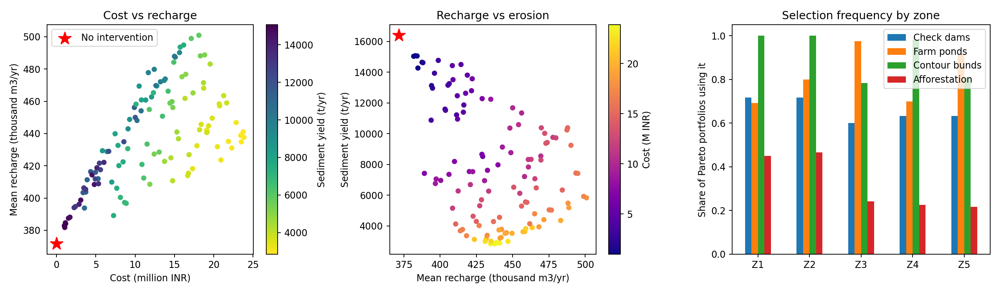

# CE 766 Watershed Management: Evolutionary Optimization of Intervention Portfolios
## Ralegan Siddhi Watershed, Parner, Ahmednagar, Maharashtra

**Student:** Jaywardhan Raghu | **Roll:** 23B0737  
**Course:** CE 766 Watershed Management (Autumn 2026)  
**Instructor:** Riddhi Singh    
**Submission Date:** October 22, 2026

---

## Overview

Multi-objective optimization study of watershed intervention portfolios in Ralegan Siddhi (Ahmednagar, Maharashtra). Uses NSGA-II to identify cost-effective combinations of check dams, farm ponds, contour bunds, and afforestation that maximize groundwater recharge while minimizing soil erosion over 2000–2023.

**Key finding:** 120 Pareto-optimal portfolios span ₹1–24 M cost, 382–501 TCM/yr recharge (+3% to +35% vs baseline), and 3,120–14,900 t/yr sediment (−81% to +10%).

---

## Files

### Data
- `imdweb_KpxNPXnE.nc` — Raw NetCDF4 downloaded from IMD containing daily gridded rainfall (0.25°, 2000–2023)
- `rain.csv` — Extracted from the above for the nearest grid cell to Ralegan Siddhi - daily gridded rain (IMD, 2000–2023, 8,766 rows)
- `pareto_portfolios.csv` — 120 Pareto-optimal solutions with decision variables and objectives

### Code
- `ralegan_portfolio_opt.py` — NSGA-II optimization script (Python 3.8+)

### Figures
- `preliminary_results.png` — 3-panel Pareto trade-off plot (300 dpi)

---

## Quick Start

```bash
pip install pymoo numpy pandas matplotlib xarray netcdf4
python ralegan_portfolio_opt.py rain.csv
```

Outputs: `pareto_portfolios.csv`, `preliminary_results.png`

---

## Results



| Metric | Baseline | Pareto (mean) | Pareto (best recharge) |
|--------|----------|---------------|------------------------|
| **Recharge** | 371.6 TCM/yr | 437.9 TCM/yr (+18%) | 500.9 TCM/yr (+35%) |
| **Sediment** | 16,394 t/yr | 8,880 t/yr (−46%) | 3,120 t/yr (−81%) |
| **Cost** | ₹0 | ₹12.1 M | ₹23.8 M |

### Intervention Selection (% of Pareto solutions)

- **Contour bunds:** 78–100% (near-universal across all zones)
- **Farm ponds:** 70–98% (dominant in mid and lower zones)
- **Check dams:** 60–72% (preferred in upper steep zones)
- **Afforestation:** 22–47% (lower cost-effectiveness vs. water harvesting)

---

## Watershed Zones (Z1–Z5)

The watershed was divided into 5 zones by topographic position, each with different runoff and infiltration characteristics:

| Zone | Position | Slope | Area (ha) | Preferred Interventions |
|------|----------|-------|-----------|------------------------|
| **Z1** | Upper steep | >10% | 220 | Check dams (high runoff capture), contour bunds |
| **Z2** | Upper-mid | 5–10% | 200 | Check dams, contour bunds |
| **Z3** | Mid | 2–5% | 210 | Farm ponds (terrain suits ponding), bunds |
| **Z4** | Lower-mid | 1–2% | 180 | Farm ponds, contour bunds |
| **Z5** | Lower | <1% | 172 | Farm ponds (max infiltration), afforestation |

Upper zones (Z1–Z2) generate high runoff and are erosion-prone, making check dams effective. Mid and lower zones (Z3–Z5) have gentler slopes where ponding is feasible, hence farm pond dominance in the Pareto set.

---

## Methodology

### Data Used

Daily rainfall for 2000–2023 was downloaded from IMD Web (https://imdweb.lwcc.in/) as a NetCDF4 file covering 18.5°–19.5°N, 74.0°–76.0°E at 0.25° resolution. The nearest grid cell to Ralegan Siddhi (19.0°N, 74.5°E) was extracted and converted to a daily CSV (`rain.csv`, 8,766 records, mean 630.8 mm/yr, range 211–1089 mm).

This rainfall series drives all three model components:

1. **Runoff (SCS-CN):** Daily rainfall → runoff volume per zone using curve numbers (78–86, varying by land cover and slope). Higher rainfall years generate more runoff available for harvesting.

2. **Recharge (Water balance):** Runoff volume is routed to structures. Check dams store 2,500 m³ per unit (60% infiltrates), farm ponds store 400 m³ (30% infiltrates), and contour bunds capture 15% extra runoff on treated area. Natural infiltration accounts for 6% of direct rainfall.

3. **Erosion (RUSLE):** Annual rainfall drives the erosivity R-factor. Interventions reduce erosion through C-factor (afforestation) and P-factor (bunds).

**Optimization:** NSGA-II simultaneously minimizes cost and sediment, and maximizes recharge and irrigated area, across 150 generations with a population of 120, subject to a ₹25 M budget cap.

---

## Data Sources

- **Primary (used):** IMD gridded rainfall — https://imdweb.lwcc.in/
- **Future (calibration):** WRIS well-level data — https://indiawris.gov.in/wris/

---

## Limitations

- CN, K, LS, C, P factors from literature; not locally calibrated
- No groundwater well-level validation yet
- Livelihood modelled as irrigable area only
- Structural degradation over time not modelled

---

## Next Steps

1. Download 1–2 WRIS well records → calibrate recharge via water-table-fluctuation method
2. Sensitivity analysis on CN (±5) and budget (±20%)
3. Final report with trade-off interpretation and recommendations

---

## References

Deb et al. (2002) NSGA-II, *IEEE Trans. Evol. Comput.*; Renard et al. (1997) RUSLE, *USDA Handbook 703*; USDA SCS (1972) CN method, *National Engineering Handbook*

---
